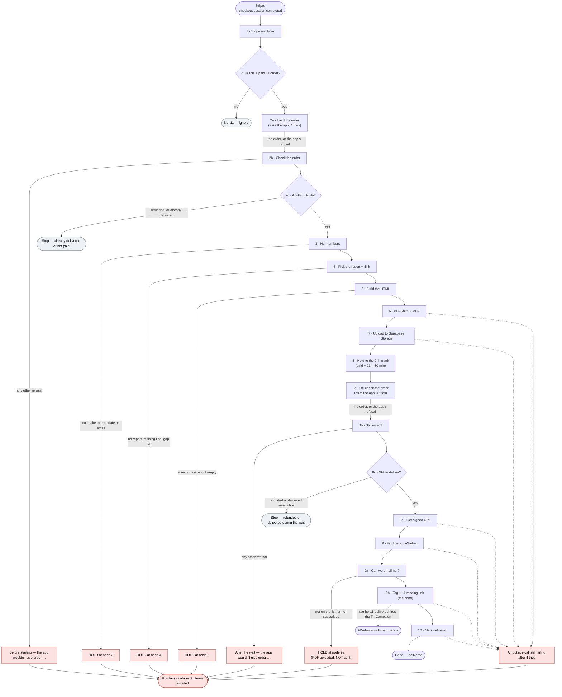

# 11 · The Unsent Letter — the delivery flow (n8n, no AI at order time)

Handover written 2026-11-06. It is for two readers:

1. **The developer** who reviews this before it goes into `development`.
2. **The operator, months from now**, who remembers none of it.

The code is the truth. Where this page and the code disagree, the code wins. Section 13 lists the
older docs that already disagree with it.

**State on 2026-11-06 (around 16:00 Singapore time).** Branch `11-unsent-letter-karmic`, last commit
`d5c0b4a4`. On top of that commit, the Closing the Door work is **not committed yet**: the new
`booking-page/11-C4-closing-the-door.md`, plus changes to `build-11-assemble.py`, `build-11-n8n.py`,
`check-11-live.py`, `check-11-chain.mjs` and the `build/` files. Also uncommitted: 12's page look ported to 11 (Evelyn's photo on the booking page, her chat header on both upsells, the new thank-you gift card) and the doc fixes listed in section 13. The live flow is built and
checked. It has **never been pushed to n8n** and is **not active**. It has been proven on n8n by a
test drive that swaps every call to the app, Supabase and AWeber for a stand-in.

**Work in a local clone (today: `~/tsw-10`), never the OneDrive copy.** OneDrive has overwritten
repo files before.

To pick this up with Claude, say:
> Read `improve-v1/v1-one-time-BEs/docs/11/n8n/HANDOVER.md`, then do the next open item in section 11.

## Contents

1. What it does, and what it does not do
2. The flow at a glance (diagram)
3. Node by node
4. Where the words come from
5. The timing
6. When something goes wrong (runbook)
7. Settings and IDs
8. How to change something safely
9. How to test
10. Known traps
11. Not done yet, review questions, costs
12. File map
13. Where older docs disagree with the code

## Words you will meet

| Word | Meaning here |
|---|---|
| **n8n** | The automation service we run at `ezyabsorb.app.n8n.cloud`. A **workflow** is one automation. A **node** is one box (one step) in it. |
| **Run** (n8n says *execution*) | One trip through the workflow for one order. |
| **Sub-run** | A run started by another workflow. The test drive starts one sub-run per invented order. |
| **Webhook** | A web address that starts a run when something sends to it. Stripe sends to ours when a buyer pays. |
| **Session id** | The Stripe Checkout id of her order, `cs_live_…` (real) or `cs_test_…` (test mode). It is the order's key everywhere. |
| **Credential** | A saved login inside n8n. The flow names credentials by ID. No password or token is in this repo. |
| **HOLD** | A deliberate stop. The run fails on purpose with a message that starts `HOLD`, n8n keeps the run's data, and the team gets an email. Nothing reaches her. |
| **Quiet stop** | The run ends on purpose with nothing to do (refunded, already delivered, not our product). No email to anyone. |
| **Error flow** | A separate n8n workflow that emails the team whenever this one fails. |
| **Soul Urge, Expression, Life Path** | Her three numerology numbers, worked out from her full birth name and date of birth. She is never told about them. |
| **Swap-in line** | A sentence from the shared list (`11-swapins.json`), picked by her Expression or Life Path and dropped into her report. |
| **Fork** | The two versions of the story: "they're giving it back" (`giving`) or "they're trying to get you back" (`get_back`). Her numbers decide which. |
| **Stand-in** | In the test drive, a box that prints what a live node *would* have sent, instead of sending it. |
| **Signed URL** | A private link to her PDF that works without a login. Ours lasts 10 years. |
| **AWeber tag / Campaign / custom field** | A tag is a label on her subscriber record. A Campaign is an email AWeber sends when a tag is added. A custom field is a value on her record that an email can print, such as her link. |
| **PDFShift credit** | PDFShift turns our HTML into a PDF. One PDF costs one credit. |

---

## 1. What it does, and what it does not do

When a buyer pays for The Unsent Letter ($35, plus $12.77 if she ticked the *Closing the Door*
bump), Stripe tells this workflow. The workflow asks our app for her order and for the birth name
and date she typed on the booking page. From those it works out her Soul Urge number, which picks
one of 12 reports we wrote and approved in advance. It fills that report with her name, her date
and a few lines chosen by her other two numbers. It turns the result into a PDF, with Closing the
Door as the last page if she bought it, and stores the PDF in Supabase. Then it waits until
23 hours 30 minutes after she paid. It checks the order again (was it refunded?), makes a 10-year
link to the PDF, and writes that link and a tag onto her AWeber record. **The tag is what makes
AWeber send her the delivery email.** Last, it tells our app the order is delivered.

What it does **not** do:

- **No AI at order time.** Every word was written and approved before she bought. The order-time
  code only picks and fills.
- **It never sends an email itself.** AWeber sends the delivery email (`11-T4`) when the tag
  `be-11-delivered` lands. The confirmation email (`11-T3`) is fired by the tag the app adds at payment, not by
  this flow.
- **It never creates an AWeber subscriber.** She has to be on the customer list already. The app
  puts her there when she pays.
- **It never trusts the Stripe message for her details.** That message is not signature-checked, so
  it only starts the run. Her email, bump, paid time, name and date all come from the app.
- **It never guesses.** Anything missing stops the run, keeps its data and emails the team.
- **It never sends the bump separately.** Closing the Door is a page inside the same PDF.

There is an **older flow** in the same folder that wrote each reading with an AI model at order time
(`build-11-n8n.py` → `build/11-fulfilment*.n8n.json`). It was dropped after its live test
(execution 51764) failed its own grader and scored 3/10 for "worth $35" in a blind read, against 8/10
for a hand-made report (`product/0-REPORT-WORKFLOW-11.md`). **It is not the flow being handed over.
Never activate it.** The new flow borrows three proven parts from it: node 2, the PDFShift node and
the PDF page (node 5).

### Where her data comes from (app side)

1. **Booking page** `/tarot/unsent-letter` → `POST /api/backend/checkout`
   (`server/routes/backendOffers.ts`). It checks her full birth name has two parts and that she is
   18 or over, opens the Stripe checkout (metadata `product: be_unsent_letter`, no personal details
   on Stripe), then saves `be_order_intake`: session id, full birth name, date of birth, and her
   first name from the email link's `?fn=`. That save is allowed to fail without blocking the sale,
   which is why node 3 can HOLD on "no intake row".
2. **She pays.** Stripe sends `checkout.session.completed` to the app **and** to this workflow.
3. **The app records the order** (`recordBackendOrder`, `server/lib/beOrders.ts`): a `be_orders` row
   with status `paid`, the bump flag and `created_at` (the paid time), and it adds her to AWeber list
   6972552 with tag `be-11-unsent-letter` (plus `be-11-bump` and list 6972554 if she took the bump).
   That tag fires T3.
4. If this workflow asks before the app has written the row, the app's fulfilment endpoint reads the
   session from Stripe and records it itself (`server/routes/beFulfilment.ts`).
5. **A full refund** in Stripe sends `charge.refunded`. The app sets `be_orders.status` to `refunded`
   (`handleBackendRefund`, `server/lib/beShipments.ts`). A partial refund changes nothing.
6. **Delivery**: node 10 posts to the app, which sets `reading_url` and `delivered_at` on `be_orders`.

---

## 2. The flow at a glance

Red boxes fail the run: n8n keeps all its data and the error flow emails the team. Grey boxes are
quiet stops: the run ends well, nothing is sent and no data is kept.



---

## 3. Node by node

23 nodes, names exactly as in `build/11-fulfilment-ASSEMBLY.n8n.json`. "4 tries" means n8n retries
the call up to 4 times, 5 seconds apart (n8n's cap on the gap).

| # | Node | What it does | What can go wrong, and what happens then |
|---|---|---|---|
| 1 | `1 · Stripe webhook` | Receives Stripe's POST at path `unsent-letter-delivery` and answers "OK" at once. Only the session id, event type, product and payment status are read from it. | If n8n is down or the workflow is off, Stripe gets an error and retries for up to three days (Stripe's documented rule, not checked here). Nothing on our side alerts anyone: there is no overdue check yet. |
| 2 | `2 · Is this a paid 11 order?` | Yes only if the event is `checkout.session.completed`, `metadata.product` is `be_unsent_letter` and `payment_status` is `paid`. | Every other checkout on the Stripe account goes to "Not 11 — ignore". A real 11 order paid by a delayed method (status `unpaid` at first) would also be ignored. See review question 2 about events with no `product`. |
| – | `Not 11 — ignore` | Does nothing. The run ends. | – |
| 2a | `2a · Load the order` | GET `https://theseerwithin.com/api/be/unsent-letter/fulfilment/<session>` with the credential "BE Fulfilment (dev)". Gets her order and intake. 4 tries. A refusal goes out of its error output to 2b instead of failing here. | Side effect: if the app has no row yet, the app records the order from Stripe (and adds her to AWeber). |
| 2b | `2b · Check the order` | Reads 2a's answer. HTTP 409 or "not paid" means refunded or cancelled: quiet stop. `deliveredAt` set: quiet stop. | Any other refusal fails the run with "Before starting — the app wouldn't give order …" and the app's own words. An answer with no order also fails. |
| 2c | `2c · Anything to do?` | Goes on only if 2b said `go`. | – |
| – | `Stop — already delivered or not paid` | Does nothing. The run ends quietly. | – |
| 3 | `3 · Her numbers` | From the intake: her Soul Urge, Expression and Life Path (same sums as `server/lib/numerologyEngine.ts`), her first name, the fork, the reason number, her next birthday and the number of the year it starts. From the order: email, bump, paid time. | HOLDs if there is no intake row, no birth name, no valid date, no first name anywhere, or no email. Messages name the field, never her details. |
| 4 | `4 · Pick the report + fill it` | All 12 reports (those that passed `check-report.py` at build time) and the shared list are baked into this node. Picks the report by Soul Urge, picks her versions, fills her lines, name and date. | HOLDs if her Soul Urge has no report in the build, a shared line is missing, any `{{…}}`, `[[`, `]]` or `⟪` is left, or card 11's quoted sentence isn't word for word in the letter. These messages carry no order id: open the run to see it. |
| 5 | `5 · Build the HTML` | Builds the PDF page: cover, the 12 cards with their pictures, the letter, the close, the sign-off, and Closing the Door last if she bought the bump. | HOLDs if any section is empty. |
| 6 | `6 · PDFShift → PDF` | Sends the HTML to PDFShift and gets the PDF back. US Letter. 4 tries. 1 credit. | PDFShift fetches the card pictures from S3 itself. A slow or refused picture fetch leaves a gap **with no error**. After 4 failed tries the run fails. |
| 7 | `7 · Upload to Supabase Storage` | Puts the PDF at `analysis_pdf/11/<session>/<session>.pdf` in the private bucket. Overwrites an earlier file at that path. 4 tries. | Has never run for real for 11. After 4 failed tries the run fails. |
| 8 | `8 · Hold to the 24h mark` | Waits until the app's paid time + 1,410 minutes (23 h 30 min). If that time has passed, it goes on at once. | A waiting run keeps the version of the flow it started on. A fix you push only reaches new orders. |
| 8a | `8a · Re-check the order` | The same GET as 2a, after the wait. | As 2a. |
| 8b | `8b · Still owed?` | The same checks as 2b, labelled "After the wait". | Refunded or delivered during the wait: quiet stop. Any other refusal fails the run. |
| 8c | `8c · Still to deliver?` | Goes on only if 8b said `go`. | – |
| – | `Stop — refunded or delivered during the wait` | Does nothing. The run ends quietly. Nothing was sent. | – |
| 8d | `8d · Get signed URL` | Asks Supabase for a link to her PDF that lasts 315,360,000 seconds (10 years). Nothing ever re-signs it. 4 tries. | After 4 failed tries the run fails. |
| 9 | `9 · Find her on AWeber` | Looks her up by email on list 6972552 (account 442730). Never creates her. 4 tries. | An expired AWeber login fails here. |
| 9a | `9a · Can we email her?` | Checks the lookup. | HOLD if she isn't on the list, or her status isn't `subscribed`. Her PDF is uploaded but not sent. |
| 9b | `9b · Tag + 11 reading link (the send)` | Updates her AWeber record: writes back every custom field she already has, sets `11_unsent_letter_reading_url` to her link, and adds the tag `be-11-delivered`. **This is the send**: the tag fires the T4 Campaign. 4 tries. | After 4 failed tries the run fails, and she has not been emailed. If AWeber did the update but the answer was lost, a retry repeats the same update. |
| 10 | `10 · Mark delivered` | POST `https://theseerwithin.com/api/be/unsent-letter/delivered` with her session id and link. The app keeps the first `delivered_at` it ever got. 4 tries. | If this fails, **she already has her email**. Only the app's row is unstamped. |
| – | `Done — delivered` | Does nothing. The run ends. No data is kept. | – |

**Run settings** (set by the build): failed runs keep all their data, successful runs keep none,
error workflow `c8hLW9ACJi5f9g0r`. So a delivered order leaves no trace in n8n at all. The record of
a delivery is in the app (`be_orders.delivered_at`, `reading_url`), in AWeber (her tag and field)
and in Supabase (the PDF).

---

## 4. Where the words come from

### 4.1 The 12 fixed reports

One report per Soul Urge: `product/11-P3-su<N>-report.md` for N = 1–9, 11, 22, 33. Each was written
once, checked, read blind against a control and approved by the operator. The method is in
`product/0-REPORT-WORKFLOW-11.md` and the `writing-paid-readings` skill.

They are not all in the same shape yet:

| Reports | Shape (line 1 of the file) | Words one buyer gets |
|---|---|---|
| SU 1–7 | "bar shape" (letter-first, one question per card, a spine picture, a dated close) | about 3,400–3,520 |
| SU 8, 9, 11, 22, 33 | the older shape | about 4,460–4,680 |

(Counts are from `check-11-assemble.py`'s 25 test buyers.)

The format of a report file (the parser is `lib11_assemble.py`; its docstring is the reference):

- Line 1 says what it is (and its shape). Line 2 lists its fill-ins. Line 3 lists its 12 cards:
  `Cards: 1 the Magician · 2 the Star · …`. Line 4 is blank.
- Then the sections, each on its own line: `[OPENING]`, `[CARD 1]` … `[CARD 12]`, `[LETTER]`,
  `[CLOSE]`.
- Inside the prose:
  - `{{FIRST}}` `{{BIRTH_NAME}}` `{{DOB}}` `{{NEXT_BDAY}}`: her first name, full birth name, date of
    birth ("November 5, 1962"), next birthday ("March 14").
  - `{{EX.saw}}`, `{{LP.then}}`, `{{REASON.headline}}`, `{{PY.ahead}}` and so on: a line from the
    shared list.
  - `[[FORK get_back]]…[[/FORK]][[FORK giving]]…[[/FORK]]` and `[[REASON 0]]…[[REASON 1]]…[[REASON 2]]`
    (each closed with `[[/REASON]]`): versions. Blocks of one tag next to each other are one choice,
    and she gets exactly one block.
  - `⟪WRITE: …⟫`: a gap still to write. A report with a gap cannot go in a build.

### 4.2 Her numbers pick the report

Worked out in node 3 (and, for tests, in `lib11_assemble.numbers()`):

- **Letter values**: a j s = 1, b k t = 2, c l u = 3, d m v = 4, e n w = 5, f o x = 6, g p y = 7,
  h q z = 8, i r = 9. Only the letters a–z count; accents and other alphabets are dropped.
- **Soul Urge** = the vowels (a e i o u) of her full birth name, added up and reduced to one digit,
  except that 11, 22 and 33 are kept. If her name has no a/e/i/o/u, `y` counts instead.
- **Expression** = all the letters, reduced the same way.
- **Life Path** = month, day and year of birth, each reduced, added, reduced again (11, 22, 33 kept).
- If a name has no letters a–z at all, node 3 makes up a steady number from the name (same name,
  same number) instead of holding the order. See review question 8.

**The Soul Urge picks the report.** Today all 12 are in the build, so no Soul Urge holds.

### 4.3 How the report is filled

| Key | Comes from | Picks |
|---|---|---|
| `EX` | Expression (a 33 uses the 6 lines) | `{{EX.<field>}}`, fields: trait, saw, praise, use, letter, never, moment, kept, last |
| `LP` | Life Path (a 33 uses the 6 lines) | `{{LP.<field>}}`, fields: trait, then, praise, now, admire, letter |
| `REASON` | Life Path made one digit (11→2, 22→4, 33→6), divided by 3, the remainder: 0, 1 or 2 | `[[REASON n]]` blocks and `{{REASON.headline letter}}` |
| `FORK` | One-digit Soul Urge + Expression + Life Path. Divisible by 3: `get_back`, else `giving` (about one buyer in three gets `get_back`) | `[[FORK …]]` blocks |
| `PY`, `NEXT_BDAY` | Her next birthday, and the number of the year it starts (month + day + that year, to one digit) | `{{PY.ahead}}`, `{{NEXT_BDAY}}` |

Her **first name**: the intake's (from `?fn=` in the email link), else the order's, else the first
word of her birth name. The booking page has no name box, so a buyer who arrives without `?fn=`
still gets her name. All-capitals or all-lowercase names are tidied ("MARY" → "Mary").

The shared lines live in `n8n/scripts/11-swapins.json`. Every line must read right in all 12
reports, so a change there affects every buyer.

**At build time** `build-11-assemble.py` parses every passing report into pieces and bakes them,
with the shared list and the card names, into node 4's code. The live flow carries the report text
inside itself. **Changing a report means rebuilding and pushing the flow.**

The fill exists twice, once in Python (`lib11_assemble.fill`, used by the checkers) and once in
JavaScript (node 4). `check-11-assemble.py` and `check-11-live.py` prove they give the same text for
every combination (12 reports × 11 Expressions × 11 Life Paths × 2 forks = 2,904).

### 4.4 The gate: `check-report.py`

The live build runs `product/scripts/check-report.py` on every file named
`11-P3-su<N>-report.md`. **Only reports that print `ALL PASS` go in.** A failing report is left out
without stopping the build, and its buyers HOLD at node 4. The build prints the held list:
`HELD (fail check-report, so these buyers HOLD at node 4 and the team is emailed): SU none`.
Read that line every time you build.

A report is set aside ("parked") by renaming it, for example `11-P3-su5-report-PARKED.md`. The
build only sees the exact name.

`check-report.py` fills one report for every buyer it can meet (11 Expressions × 11 Life Paths ×
2 forks = 242 readings, × 9 year numbers if the report uses them) and checks each one: it parses,
no gaps, the 12 cards are legal (each from its act's pool, the fixed cards 1–2 per Soul Urge for the
bar shape, Death only at 8 or 10, no card twice), every shared line sits in its exact frame, the
required lines are there, banned words are absent (numerology words, words for what the person
was, hedges, therapy words, British words), "years" only in card 8, word counts are in range. It
does not judge voice or story. That is the blind read's job.

### 4.5 The PDF page, and Closing the Door

Node 5 builds one HTML page that PDFShift prints (code: `HTML_JS` in `build-11-n8n.py`):

- A dark cover: "The Unsent Letter", "Written out for <her birth name> · <the date she paid, US
  Eastern time>", four rows of face-down cards named for the four acts, an envelope.
- A title, the opening, then four acts of three cards. Each card shows its picture
  (`https://luna-assets-tsw.s3.ap-southeast-2.amazonaws.com/evelyn/tarot-rws/<card>.jpg`, chosen from
  the report's line 3, never from the text). In the bar shape, the card's first bold line becomes
  its heading. Death is cropped (`death_crop` in `11-acts.json`).
- The letter on its own page, the close, Evelyn's sign-off and a short note: "About this reading:
  your twelve cards were set by your birth name and date. The words are written in Evelyn's voice."
- **Bump buyers only: Closing the Door, alone on the last page.**

Closing the Door's text lives in `booking-page/11-C4-closing-the-door.md`, under `## The page`, up
to the first line that is exactly `---`. The build reads it (`_closing_the_door_html()` in
`build-11-n8n.py`) and refuses to build if the page breaks its rules: one `### ` title, plain
paragraphs, one numbered list, nothing else, at most 310 words. Straight quotes become curly ones.
Whether she gets it comes from the app's `bumpPurchased`, never from Stripe's message.

If that file goes missing, the build still works but falls back: bump buyers get the reading
without the page, and two extra nodes (`10a`, `10b`) fail the run after delivery to tell the team
the page is owed. The current build has 23 nodes and no fallback.

Proof: the page fits one page in a local render (`n8n/runs/c4-fit.pdf`), and n8n run 52613 (one
bump order, Peggy, SU 7, through the live chain test drive) made a 16-page PDF with Closing the Door
alone on page 16 (`n8n/runs/11-n8n-52613-su7-peggy-bump.pdf`, made by PDFShift).

---

## 5. The timing

| When | What happens | Why |
|---|---|---|
| Seconds after she pays | Stripe starts the run. Nodes 2a to 7 run straight away: the order, her numbers, her report, the PDF, the upload. | Any fault (missing intake, a held report, PDFShift down) shows up in the first minutes, with about 23 hours to fix it before she is owed anything. |
| Then | Node 8 waits until **paid + 23 h 30 min**. "Paid" is the app's `paidAt`, which is `be_orders.created_at`, written when the payment is recorded. | Every page tells her "within 24 hours", and the sales story says Evelyn takes 24 hours to write it out. So it must not land early by hours. The 30 minutes leave room for AWeber to send the email after the tag lands. |
| At the mark | Node 8a asks the app again. Fully refunded or already delivered: quiet stop, nothing sent. | She may have asked for a refund during the wait. |
| Right after | Link, AWeber lookup, the tag (the send), mark delivered. | – |

Things worth knowing:

- If the run starts late, the wait still aims at paid + 23 h 30 min. If that time has already passed
  (a run restarted days later), the wait ends at once.
- Waiting runs show as **Waiting** in n8n's Executions list. That is the only place in n8n where you
  can see orders in progress.
- **A waiting run keeps the version of the flow it started on.** Push a fix and the orders already
  waiting still finish on the old version.
- **The real 23-hour wait has never been run.** The test drive's longest wait is 25 seconds. n8n's
  documentation says waits under 65 seconds stay in memory and longer ones are saved to its database
  and resumed later. That second path is untested here (open item 6).

---

## 6. When something goes wrong (runbook)

### 6.1 First steps when the team email arrives

The error flow "The seer within Error Flow - To send email if there is any error"
(`c8hLW9ACJi5f9g0r`) emails the team whenever a run fails. What the email shows, and who gets it,
is set in that workflow, not in this repo (unverified).

1. In n8n, open this workflow → **Executions** → the failed run.
2. Find the red node and read its message.
3. Find the message in 6.3 below. Fix the cause.
4. Restart the right way (6.2).
5. **Delete the failed run when you're done.** Failed runs keep her birth name, date, email and PDF.

Note: n8n's Code nodes keep only the text after the **last colon** of an error. That is why no
message here contains a colon.

### 6.2 Restarting a run the right way

n8n's **Retry** on a failed run starts again **at the node that failed**, feeding it the saved
answers of the nodes before it. (This is how n8n retries work. It has not been tried on this flow.)
So:

| Where it failed | How to restart |
|---|---|
| An outside call: node 6, 7, 8d, 9, 9b or 10 | Fix the service, then **Retry**. Only that node runs again. |
| Node 4 or 5, because of a report or the code | Fix it, rebuild, check and push (section 8), then **Retry with currently saved workflow**. Node 4 runs again with the new reports. |
| A check that read an earlier answer: node 2b, 3, 8b or 9a | Retry would re-read the same old answer and fail again. Fix the cause, then **start a fresh run** (below). |
| Node 10 | **Retry only.** She already has her email. Never start a fresh run for it. |

**Starting a fresh run.** Either:

- **A.** Stripe Dashboard → Developers → Webhooks → the n8n endpoint → find her
  `checkout.session.completed` event → **Resend** (while Stripe still lists the event: about 30 days by Stripe's documentation, not checked here).
- **B.** Send the event by hand. The flow only reads four fields:

  ```
  curl -X POST https://ezyabsorb.app.n8n.cloud/webhook/unsent-letter-delivery \
    -H 'content-type: application/json' \
    -d '{"type":"checkout.session.completed","data":{"object":{"id":"cs_live_…","payment_status":"paid","metadata":{"product":"be_unsent_letter"}}}}'
  ```

A fresh run makes a new PDF (1 PDFShift credit) and overwrites the old file at the same path. If
it's past the 24-hour mark, the wait ends at once and she gets her email within a minute or two.
If she's already been delivered, the fresh run stops quietly at 2b.

**Her link, if you need to send it by hand**: in the failed run, open node `8d · Get signed URL`.
Her link is `https://pqolqzddzxubquukxnhk.supabase.co/storage/v1` followed by its `signedURL` value.
For a delivered order, it is in `be_orders.reading_url` and in her AWeber field.

### 6.3 Every message, what it means, what to do

**Nodes 2b and 8b (asking the app).** The same messages appear twice: starting with
"Before starting" (node 2b, before any work) or "After the wait" (node 8b, after the PDF was made
and uploaded). `<session>` is her session id.

| Message | Means | Do |
|---|---|---|
| `Before starting — the app says this order isn't paid any more (refunded or cancelled). Nothing sent.` | Quiet stop: she was refunded. | Nothing. (You won't see this in n8n: successful runs keep no data.) |
| `Before starting — already delivered at <time>. Not sent again.` | Quiet stop: a second event for a delivered order. | Nothing. |
| `… — the app wouldn't give order <session> (HTTP 401, it said Unauthorized)` | The n8n credential "BE Fulfilment (dev)" doesn't match `BE_FULFILMENT_TOKEN` on the app. | Fix the credential in n8n (or the app's env var). Start a fresh run. |
| `… (HTTP 503, it said Fulfilment token not configured on server)` | The app has no `BE_FULFILMENT_TOKEN` set. | Set it on the app and redeploy. Start a fresh run. |
| `… (HTTP 404, it said Unknown offer.)` | The app at theseerwithin.com doesn't know offer 11 yet. 11's code isn't on Production. | Deploy 11 to Production. Start a fresh run. |
| `… (HTTP 404, it said Order not found.)` | The session isn't an 11 order (another product, or another offer's row). | Check the session in Stripe. Usually nothing to do. |
| `… (HTTP 402, it said This order has not been paid.)` | The app had no row and Stripe says the session isn't paid. | Check Stripe. If it does get paid, start a fresh run. |
| `… (HTTP 500, it said Could not load the order.)` | The app hit a database or Stripe error. Its log line is `be-fulfilment: fulfilment lookup failed`. | Fix the app. Start a fresh run. |
| `… (HTTP ?, it said …)` | No status code: a timeout, or the app is down. | When the app is back, start a fresh run. |
| `… — the app answered without an order for <session>` | The app answered "OK" with no order in it. Shouldn't happen. | Developer. Then start a fresh run. |

**Node 3 · Her numbers**

| Message | Means | Do |
|---|---|---|
| `HOLD <session> — no intake row. Her birth name and date never saved at checkout, so there is nothing to read from.` | The intake save at checkout failed. | Ask her (from support) for her full birth name and date of birth. Have a developer add the `be_order_intake` row (session id, offer `unsent-letter`, full birth name, date of birth). Start a fresh run. Or refund. |
| `HOLD <session> — no full_birth_name on the intake` | The row exists but the name is empty. | Same: fix the row, start a fresh run. |
| `HOLD <session> — no valid date_of_birth on the intake` | The date is empty or not `YYYY-MM-DD`. | Same. |
| `HOLD <session> — no first name anywhere and none in her birth name` | No `?fn=`, no name on the order, and no word in her birth name made of plain letters. | Add a `first_name` to her intake row. Start a fresh run. |
| `HOLD <session> — the app's order has no email` | `be_orders.email` and the intake email are both empty. She probably isn't on AWeber either. | Find her email in Stripe, set it on the order, check she's on list 6972552. Start a fresh run. |

**Node 4 · Pick the report + fill it** (these carry no session id: see node 3's output in the run)

| Message | Means | Do |
|---|---|---|
| `HOLD — no fixed report for Soul Urge <N> yet (cleared so far <list>)` | Her report wasn't in the build: it failed `check-report.py`, is parked, or is missing. | Fix the report until it passes, rebuild, check, push. **Retry with currently saved workflow.** Or refund. |
| `HOLD — no shared line yet for <TAG number field> · …` | A line is missing from `11-swapins.json` for her number. | Add it, run `check-report.py` on all 12, rebuild, push, Retry with currently saved workflow. |
| `HOLD — unfilled spot(s) left in the reading <what was left>` | A `{{…}}` the fill doesn't know (a typo), or a stray `[[`, `]]` or `⟪`. | Fix the report, then as above. |
| `HOLD — the unsaid sentence is not in both card 11 and the letter` | Card 11's first quoted sentence isn't word for word in the letter, in her version. | Fix the report, then as above. |

The checkers should catch all four before a push. Seeing one live means a check was skipped.

**Node 5 · Build the HTML**

| Message | Means | Do |
|---|---|---|
| `HOLD — the reading has no text for <sections>` | A section came out empty in her version (for example an empty version block was the whole section). | Fix the report, rebuild, push, Retry with currently saved workflow. |

**Nodes 6, 7, 8d, 9, 9b, 10 (outside calls).** After 4 tries the run fails with n8n's own wording,
for example "Authorization failed - please check your credentials", "The service was not able to
process your request" or a timeout (exact wording unverified).

| Node | Likely cause | Do |
|---|---|---|
| `6 · PDFShift → PDF` | PDFShift down, out of credits, or the credential is wrong. | Fix, then Retry. |
| `7 · Upload to Supabase Storage` / `8d · Get signed URL` | Supabase down, the bucket `analysis_pdf` missing, or the credential is wrong. | Fix, then Retry. |
| `9 · Find her on AWeber` | The AWeber login ("Aweber for Heart Readr") expired, or a rate limit. | Reconnect the credential in n8n, then Retry. |
| `9b · Tag + 11 reading link (the send)` | AWeber refused the update. A missing custom field on the list is the likeliest. | Look at her record in AWeber first. If `be-11-delivered` is already on her, the email has gone. Otherwise fix (create the field) and Retry. |
| `10 · Mark delivered` | The app is down or refused. **She already has her email.** | Retry when the app is back. Never start a fresh run. |

**Node 9a · Can we email her?** Her PDF is uploaded but nothing was sent.

| Message | Means | Do |
|---|---|---|
| `HOLD <session> — she isn't on the customer list (AWeber 6972552). Her reading is uploaded but NOT sent. Add her, then start her order again from the beginning (Retry reuses the old lookup and fails again), or email her the link by hand.` | The app's AWeber add at payment failed, or she's under another email. | Add her to list 6972552, then **start a fresh run** (despite the message, a plain Retry re-reads the old empty lookup). Or email her the link by hand (6.2). |
| `HOLD <session> — her AWeber status is "<status>", so the delivery email can't reach her. Her reading is uploaded but NOT sent. Email her the link by hand.` | She unsubscribed (or is unconfirmed). AWeber won't email her. | Email her the link by hand from support. |

**Only in a fallback build (if the Closing the Door file is missing):**
`Delivered the main reading for <session>. She also paid for Closing the Door (11-C4), which isn't written — send it by hand or refund the bump.`
She has her reading without the bump page. Send her the page by hand or refund $12.77. Restore the
file, rebuild, push.

### 6.4 Questions from buyers

| She says | Do |
|---|---|
| "Where's my reading?" (under 24 hours) | Normal. To confirm, n8n → Executions → Waiting. |
| "Where's my reading?" (over 24 hours) | 1. Check `be_orders` for her session. `delivered_at` set: it was sent. Give her `reading_url` and ask her to check promotions and spam. 2. Not delivered: look for a failed run (6.3). 3. No run at all: Stripe → Webhooks → the n8n endpoint → her event's delivery attempts. Start a fresh run. (This is the gap the missing overdue check would close.) |
| "I want a refund" (before delivery) | Refund the **full** payment in Stripe. The app marks the order refunded and the waiting run stops at 8b with nothing sent. **A partial refund (only the bump, say) does not stop delivery**, and her PDF still ends with Closing the Door. |
| "I want a refund" (after delivery) | Nothing to do in this flow. |
| "I typed my birth details wrong" | No built path (11-DELIVERABLES: she replies to support). A way that has **not** been tried: a developer corrects her `be_order_intake` row and empties `be_orders.delivered_at`; start a fresh run; the new PDF overwrites the old one. AWeber may not send T4 again, because the tag is already on her (unverified), so email her the new link (`be_orders.reading_url`) by hand. |

---

## 7. Settings and IDs

| What | Value | Where it lives |
|---|---|---|
| n8n instance | `ezyabsorb.app.n8n.cloud` | `.env` `N8N_BASE_URL` (names only; read by the push script). Not in 11's code. |
| Live workflow on n8n | **none yet**. Write its id here after the first push. | – |
| Webhook path | `unsent-letter-delivery` | `WEBHOOK_PATH`, `build-11-assemble.py` |
| Webhook address for Stripe | `https://ezyabsorb.app.n8n.cloud/webhook/unsent-letter-delivery` (n8n's standard form; confirm on the node's "Production URL") | – |
| Old AI flow's path (never activate) | `unsent-letter-fulfilment` | `build-11-n8n.py` |
| Stripe event and product | `checkout.session.completed`, `metadata.product = be_unsent_letter` | node 2; product from `11-acts.json` `offer.stripe_product` = `shared/backendOffers.ts` |
| App base address | `https://theseerwithin.com` (Production) | `APP_BASE_URL`, `build-11-assemble.py` |
| App endpoints | `GET /api/be/unsent-letter/fulfilment/<session>`, `POST /api/be/unsent-letter/delivered` | `server/routes/beFulfilment.ts`, mounted at `/api/be` in `server/routes.ts` |
| App login | Header `Authorization: Bearer <BE_FULFILMENT_TOKEN>`, compared in constant time. Wrong: 401. Unset on the server: 503. | `requireFulfilmentToken`, `beFulfilment.ts` |
| n8n credential: app | "BE Fulfilment (dev)", `47WIHYBv4f0n4w8C`, header auth. Despite "(dev)", 08's live flows use it against Production. | `FULFIL_CRED`, `build-11-assemble.py` |
| n8n credential: PDFShift | "pdfshift-header-auth", `8TelHH6oJEzYzw2r` | `PDFSHIFT_CRED`, `build-11-n8n.py` |
| n8n credential: Supabase | "wealth-scriba-customer-report-generator", `Xu3vjsJHaiLZ1ILQ` | `SUPABASE_CRED`, `build-11-n8n.py` |
| n8n credential: AWeber | "Aweber for Heart Readr", `InacwW76ep6ltnUU`, OAuth2 | `AWEBER_CRED`, `build-11-n8n.py` |
| Error workflow | "The seer within Error Flow - To send email if there is any error", `c8hLW9ACJi5f9g0r` | `ERROR_FLOW`, `build-11-assemble.py` |
| Test-drive workflow | `yJOu9VK7SG0aFzyW` (inactive) | `TEST_WF_ID`, `build-11-assemble.py` |
| PDFShift | `POST https://api.pdfshift.io/v3/convert/pdf`; `format: Letter`, `margin: 0`, `use_print: true`, `sandbox: false`; returns a file; 120 s timeout. The page's own CSS sets 0.6 in top and bottom margins and the page-number footer. | node "11 · PDFShift → PDF" in `build-11-n8n.py`, reused as node 6 |
| Card pictures | `https://luna-assets-tsw.s3.ap-southeast-2.amazonaws.com/evelyn/tarot-rws/<card>.jpg` | `S3`, `build-11-n8n.py`. Never overwrite the older `evelyn/tarot/` folder. |
| Font | Gelasio (normal and italic), embedded in the page | `n8n/scripts/fonts/` (OFL licence beside it) |
| Supabase | project `https://pqolqzddzxubquukxnhk.supabase.co`, private bucket `analysis_pdf`, file `11/<session>/<session>.pdf`, overwrite on (`x-upsert`) | `SUPABASE_PROJ`, `SUPABASE_BUCKET` in `build-11-n8n.py` |
| Her link | lasts 315,360,000 s (10 years) | `SIGN_SECONDS`, `build-11-assemble.py` |
| Wait | paid + 1,410 min (23 h 30 min) | `WAIT_MINUTES`, `build-11-assemble.py` |
| Retries | 4 tries, 5 s apart, on all 8 outside calls | `RETRY`, `build-11-assemble.py` |
| AWeber | account `442730`, customer list `6972552` | `AWEBER_ACCOUNT`, `AWEBER_LIST` in `build-11-n8n.py`; list also in `server/lib/backendCustomerList.ts` |
| AWeber field | `11_unsent_letter_reading_url` (11's own; never the shared `reading_url`) | `AWEBER_FIELD`, `build-11-assemble.py` |
| AWeber tags | `be-11-delivered` (written by this flow, fires T4); `be-11-unsent-letter` (written by the app at payment, fires T3); `be-11-bump` (app, a segment only). Bump list `6972554`. | `11-acts.json` `offer.delivered_tag`; `server/lib/backendCustomerList.ts` |
| Live run settings | failed runs: keep all; successful: keep none; manual: keep; error workflow set | `build_live()` |
| Test-drive run settings | keep all; **no error workflow** | `build_live_drive()` |
| Push script keys | `N8N_API_KEY`, `N8N_BASE_URL` (env, or the repo's `.env`) | `push-11-n8n.py` |

---

## 8. How to change something safely

### 8.1 Rules

- **Edit the generator, the reports and `11-swapins.json`. Never edit the built JSON.** The files in
  `build/` are output; the next build overwrites them.
- Run commands from `<repo>/improve-v1/v1-one-time-BEs/docs/11` (for `check-report.py`) or
  `…/docs/11/n8n` (for everything else). Python 3.12 or newer is needed (`build-11-n8n.py` uses a
  backslash inside an f-string).
- Commit the source and the rebuilt `build/` files together.
- A push only changes new orders. Orders already waiting finish on the old version.

### 8.2 Change a report

1. Edit `product/11-P3-su<N>-report.md`. Copy the frames and structure of a report in the same
   shape; the exact frames are `FRAMES` in `check-report.py`.
2. From `docs/11`: `python3 product/scripts/check-report.py product/11-P3-su<N>-report.md`.
   Fix until it prints `ALL PASS`. If it fails, the build will quietly leave the report out and
   that Soul Urge will HOLD.
3. Read it yourself. For anything beyond a small fix, run a blind read and get the operator's
   approval (`product/0-REPORT-WORKFLOW-11.md`, steps 4–6).
4. From `docs/11/n8n`: `python3 scripts/build-11-assemble.py --live --testdrive`. It writes
   `build/11-fulfilment-ASSEMBLY.n8n.json` and `build/11-fulfilment-ASSEMBLY-TESTDRIVE.n8n.json`.
   Check the output says `HELD …: SU none` and `TODOs left: none`.
5. `python3 scripts/check-11-assemble.py` → `ALL MATCH`. `python3 scripts/check-11-live.py` →
   `ALL PASS`.
6. Commit.
7. Test drive on n8n (section 9.3) with only the orders you need, for example
   `--orders su1-giving`. For SU 22 or 33 see 9.3: no drive order reaches their PDF.
8. Push the live flow (8.6).

### 8.3 Change a shared line (`11-swapins.json`)

Same steps, but run `check-report.py` on **all 12 reports** at step 2: a shared line lands in every
report. Its `_note` explains the keys.

### 8.4 Change Closing the Door

1. Edit the text under `## The page` in `booking-page/11-C4-closing-the-door.md`. Allowed: one
   `### ` title, plain paragraphs, one numbered list (`1. …`). No other markdown: no `*`, `_`,
   backticks, `[`, and no lines starting with `-`, `>`, `#` or `|`. At most 310 words. The page ends
   at the first line that is exactly `---`.
2. Keep the title "Closing the Door", or also change the check in `check-11-live.py` that looks for
   `<h2>Closing the Door</h2>`.
3. Keep it true to what `11-C3` (the bump copy) and `11-T1` (the thank-you page) promise: one page,
   done once, after reading the letter, nobody else involved.
4. Rebuild (8.2 step 4) and run both checkers.
5. Test drive with `--orders bump` (1 credit). Download Peggy's PDF and check Closing the Door sits
   alone on the last page.
6. Push. PDFs already delivered don't change.

### 8.5 Change the PDF look

1. The page and its CSS are `HTML_JS` in `build-11-n8n.py`, shared with the old AI flow.
   **No backticks anywhere in it** (one ends the JavaScript text and the node stops working).
2. `build-11-assemble.py` (`html_and_fill`) edits that code for the live flow. It expects two
   exact lines to be there (the old bump HOLD line and the last `return` line) and stops the build if
   either changes. It also swaps the closing note's "written with machine help in Evelyn's voice"
   for "written in Evelyn's voice"; that swap fails silently if you reword the note.
3. Rebuild and run both checkers.
4. Preview locally (9.2). Then test drive with `--orders normal,bump` (2 credits) and page through
   the PDFShift PDFs: no card heading alone at the bottom of a page, all 12 pictures there, the
   letter on its own page, Closing the Door alone on the last page.
5. Push.

### 8.6 Push to n8n

1. From `docs/11/n8n`: `python3 scripts/push-11-n8n.py --live --dry-run`. It prints the name and
   node count and sends nothing.
2. First time: `python3 scripts/push-11-n8n.py --live`. This **creates a new workflow** and prints
   its id. Write the id in section 7.
3. Every later time: `python3 scripts/push-11-n8n.py --live --update <id>`.
4. The script refuses a build that is active, still has a TODO, or has no error workflow. It never
   activates.
5. **After every push, open the workflow in n8n and check by hand:** Settings → Error workflow is
   "The seer within Error Flow…"; failed runs are saved; successful runs are not; the webhook path
   is `unsent-letter-delivery`; and, if it was active, that it still is (unverified whether an
   update keeps it active).
6. **Never paste the live flow into the editor.** Pasting copies nodes and links but not Settings (from
   earlier sessions, unverified), so the error email and the data rules would be lost without any warning.
7. **Turn it on in the n8n editor, not by the API.** An API activation doesn't register the webhook.

---

## 9. How to test

### 9.1 Free local checks

All free: no n8n, no network. Results on 2026-11-06 are in the last column.

| Command | Proves | Doesn't prove | Today |
|---|---|---|---|
| `python3 product/scripts/check-report.py product/11-P3-su<N>-report.md` (from `docs/11`) | One report, for every buyer it can meet (4.4). This is the gate for the live build. | Voice, story, blame: the blind read does that. | All 12: ALL PASS |
| `python3 scripts/check-11-assemble.py` | The JavaScript fill and the Python fill give the same text on all 2,904 combinations; 25 invented buyers run end to end (numbers, keys, reading) and match Python. | The live wiring. n8n itself. | ALL MATCH |
| `python3 scripts/check-11-live.py` | The live build: inactive; no TODO; error flow set; successful runs keep no data; its own webhook path; all 8 outside calls retry; the app calls use the n8n credential and no token is typed in. Email, bump and paid time come from the app. Refund and delivered checks before the work and after the wait. AWeber not-found and unsubscribed HOLD before the send. The send writes only 11's field. Wait = paid + 1,410 min. Closing the Door in node 5, no `10a`/`10b`. No colon in any thrown message. Live node 4 = Python on 2,904 combinations. Held reports HOLD. The test drive calls out only to PDFShift and the login probe, has no error flow and no AWeber login. | Anything on real n8n, PDFShift, Supabase, AWeber or the app. | ALL PASS |
| `npx tsx scripts/check-11-numbers.mjs [N]` | The old AI flow's number sums against `server/lib/numerologyEngine.ts` on N random buyers. The live node 3 uses the same sums. | The live node 3 directly (review question 13). | 20 of 21. The one failure is about rows in `11-acts.json` that only the old AI flow uses. |
| `node scripts/check-11-architecture.mjs`, `check-11-promises.mjs`, `check-11-testdrive.mjs`, `check-11-chain.mjs`, `check-11-draw.mjs` | The **old** AI flow: prompts, model calls, its loop, its own test drives. `check-11-chain.mjs` also renders the shared page (it writes `runs/chain-diane.*`). | The live flow. | 29/29, 53/53, 51/51 (chain and draw not run for this page; 0-REPORT-WORKFLOW-11 records chain 39/39) |

### 9.2 Preview the PDF on this machine

```
cd <repo>/improve-v1/v1-one-time-BEs/docs/11/n8n
python3 scripts/build-11-assemble.py                 # writes build/11-assemble-TEST.n8n.json (25 invented buyers)
node scripts/run-11-assemble.cjs build/11-assemble-TEST.n8n.json --out /tmp/11-test.json --html runs
node scripts/make-11-pdf.mjs --from Carol            # runs/Carol.html → runs/Carol.pdf
```

`run-11-assemble.cjs` runs the flow's code nodes on this machine and writes one HTML per buyer
(named by first name). `make-11-pdf.mjs` prints it with the local Chromium at PDFShift's settings
and reports broken pictures. It is close to PDFShift but not the same. None of the 25 test buyers
has the bump, so this doesn't show Closing the Door. `runs/` is ignored by git.

### 9.3 The n8n test drive (the live chain, nothing sent)

**What it is.** `build/11-fulfilment-ASSEMBLY-TESTDRIVE.n8n.json`: the live flow's 23 nodes plus 5
test nodes. `T1` makes 15 invented orders. `T2 · Run each through the live chain` starts this same
workflow once per order, entering at a box named `1 · Stripe webhook`, so every live node runs on
each order as it would live. Seven nodes are swapped for stand-ins that print what they would send,
built from the same expressions as the live nodes: `2a`, `8a`, `7`, `8d`, `9`, `9b`, `10`. PDFShift
is real. `T9` is the one other real call: the app's order lookup with the live login, for a made-up
session.

**Steps.**

1. Build: `python3 scripts/build-11-assemble.py --live --testdrive` (all 15 orders), or add
   `--orders normal,bump` to run only some. The build lists the order names if you mistype one.
2. Open the test workflow:
   `https://ezyabsorb.app.n8n.cloud/workflow/yJOu9VK7SG0aFzyW`. It must be **this** workflow:
   `T2` calls it by id.
3. Select everything on the canvas and delete it. Paste the whole test-drive JSON file in. **Save.**
   (`T2` runs the *saved* version.)
4. Open Settings and check: **Error workflow is empty**, and successful runs are saved. Pasting
   doesn't change Settings, so whatever was set there before stays. Leave the workflow inactive.
5. Click **Execute workflow**. It takes about a minute: the `normal` order waits 25 seconds at
   node 8 (you'll see it as Waiting); the others are already past their mark.
6. Open **Executions**. You'll see the parent run and one sub-run per order. Read each sub-run and
   compare where it ended with its order's `expect` (in `T1`'s code, under `_script.expect`):
   `^delivered` means it reached `Done — delivered`; `^ignored` means `Not 11 — ignore`; any other
   text should appear in the failed node's message or in the Stop node's `why`.
7. In the delivered sub-runs, open the stand-ins to see exactly what would have been sent:
   node 7 `_would_post_pdf_to`; node 8d `_would_sign`; node 9b `_would_patch`, `custom_fields`,
   `tags` (check `reading_url` still says "another offer's link: must come back untouched", which
   proves other offers' fields are left alone); node 10 `_would_post_to` and `_body`.
8. Download each PDF: open node `6 · PDFShift → PDF` in that sub-run, then its binary output.
   Page through it.
9. Read `T9a · Read the probe` in the parent run: **404 "Unknown offer."** = the login works and 11
   isn't on Production yet. **401** = the credential is wrong. Once 11 is on Production, expect
   **500 "Could not load the order."** for the made-up session; that still proves the login.

**The 15 invented orders.** Invented names, `example.com` emails, `cs_test_11_drive_…` ids.

| Order | Invented buyer | Proves | Should end at |
|---|---|---|---|
| `normal` | Carol (SU 5, giving) | The whole chain. The Wait node visibly holds. | Done — delivered |
| `no-first-name` | Sherry (SU 6, get back) | No `?fn=` and no name on the order: her name comes from her birth name. | Done — delivered |
| `bump` | Peggy (SU 7, giving, bump) | Closing the Door is the PDF's last page. | Done — delivered |
| `refunded-in-wait` | Testina (SU 9, get back) | A refund during the wait stops it before anything is sent. | Stop — refunded or delivered during the wait |
| `not-on-aweber` | Sharon (SU 8, giving) | Not on the list: HOLD, PDF made, nothing sent. | Fails at 9a, "isn't on the customer list" |
| `unsubscribed` | Joyce (SU 11, giving) | Unsubscribed: HOLD. | Fails at 9a, `status is "unsubscribed"` |
| `already-delivered` | Debra (SU 22) | A second event for a delivered order does nothing. | Stop — already delivered or not paid |
| `refunded-before` | Vicki (SU 33) | Refunded before the start: no work done. | Stop — already delivered or not paid |
| `no-intake` | Karen (SU 22) | No birth details: HOLD at 3. | Fails at 3, "no intake row" |
| `not-11` | Diane (another product) | Other products are ignored. | Not 11 — ignore |
| `app-down` | Judith (SU 1) | The app answering 500 fails loudly and quotes what the app said. | Fails at 2b, "HTTP 500, it said Internal Server Error" |
| `su1-giving` | Rhonda (SU 1, giving) | The SU 1 report through the chain. | Done — delivered |
| `su2-get-back` | Marsha (SU 2, get back) | SU 2. | Done — delivered |
| `su3-giving` | Linda (SU 3, giving) | SU 3. | Done — delivered |
| `su4-get-back` | Sandra (SU 4, get back) | SU 4. | Done — delivered |
| `held-report` | (added by the build only while some report fails `check-report.py`) | A held report HOLDs. | Fails at 4, "no fixed report for Soul Urge N" |

**Cost.** One PDFShift credit per order that reaches node 6. A full drive makes **10 PDFs**:
`already-delivered`, `refunded-before`, `no-intake`, `not-11` and `app-down` stop first and cost
nothing. Use `--orders` to spend less.

**Gap: SU 22 and SU 33 never reach a PDF in the drive.** Their only orders stop early. To see their
PDFs on n8n, use the older assembly-only test flow:
`python3 scripts/build-11-assemble.py --testdrive --pick karen,diane` → paste
`build/11-assemble-TESTDRIVE-MANUAL-PICK.n8n.json` into any inactive workflow → Execute → download
from its PDFShift node (2 credits). It has no delivery nodes and never calls the app.

**Reading runs with a script.** `node scripts/read-11-run.mjs <execution id> --build
11-fulfilment-ASSEMBLY-TESTDRIVE.n8n.json` (public API, keys from `.env`) prints a run's status, the
nodes that ran, any error, and whether the run's nodes match the local build. It was written for the
old AI flow, so it always ends with "no finished reading" on these runs. Never save a real buyer's
run with it. Calling n8n's internal `/rest` API from the browser (instead of the public API) needs
the header `browser-id`, whose value is in the browser's localStorage under `n8n-browserId`
(from earlier sessions; not recorded in the repo, unverified).

### 9.4 Run history

| n8n run | What | Result | Recorded in |
|---|---|---|---|
| 51764 | Old AI flow writing a reading live | Failed its own grader twice; 3/10 in a blind read. AI writing dropped. | `product/0-REPORT-WORKFLOW-11.md` |
| 52380 | A PDF through PDFShift | PDFShift's Chrome has no Georgia; a Times face made 12–13 pages instead of 14. Gelasio is now embedded. | comment in `build-11-n8n.py` |
| 52507, 52534 | PDFs | A card heading ended a page with its picture on the next. The heading now carries an invisible 3.9 in tail. | comment in `build-11-n8n.py` |
| 52533 | The `T9` probe | Showed the exact shape n8n gives a refused call, which 2b and 8b now read. | comment in `build-11-assemble.py` |
| 52542 | Live chain | The team's email showed only the text after the last colon. No colons since. | comment in `check-11-live.py` |
| 52546 | Live chain test drive | The parent run crashed after the last order while waiting for sub-runs. `T2` no longer waits. (Its sub-run numbers, 52547–52558, aren't recorded in the repo.) | `build-11-assemble.py`, commit `d5c0b4a4` |
| 52591 | Live chain test drive, sub-runs 52592–52600 | All 9 orders run ended where expected. SU 1–4 PDFs built (52597–52600). Card headings checked on 10 PDFs, none split. Which 9 orders ran isn't recorded. | commit `d5c0b4a4`, `0-REPORT-WORKFLOW-11.md` |
| 52613 | One bump order (Peggy, SU 7), after Closing the Door was added | Delivered, no alert node ran, 16-page PDF with Closing the Door alone on page 16. | `0-REPORT-WORKFLOW-11.md` (added 2026-11-06), `runs/11-n8n-52613-su7-peggy-bump.pdf` |

---

## 10. Known traps

**n8n**

- **Colons.** A Code node keeps only the text after the last colon of a thrown error, and that is
  what the team's email shows (run 52542). `check-11-live.py` checks the fixed text of every thrown
  message. It can't check values put in at run time.
- **The test drive must never carry an error workflow.** Its sub-runs aren't "manual" runs, so a
  test order that HOLDs would email the team. The build refuses to add one. Also check the test
  workflow's own Settings, since pasting leaves old Settings in place.
- **Pasting drops Settings** (from earlier sessions; not recorded in the repo, unverified). Put the
  live flow up with the push script, then check Settings by hand.
- **Execute Workflow and waiting.** With "wait for sub-workflow" on, the node crashed after the last
  order (run 52546), because a held or stopped order never hands a result back. Without waiting it
  hands back its own input, so the parent run tells you nothing. Read each sub-run.
- **`T2` runs the saved version of `yJOu9VK7SG0aFzyW`.** Save before Execute. If that workflow is
  ever deleted or replaced, change `TEST_WF_ID` in `build-11-assemble.py`.
- **API activation doesn't register the webhook.** Turn the live flow on in the editor.
- **A waiting run keeps its starting version.** Fixes only reach new orders.
- **Retry starts at the failed node** with the old saved answers (6.2). The 9a message's "then retry
  this run" is likely wrong.
- **Successful runs keep no data.** You can't look up a delivered or refunded order in n8n.
- **n8n won't save a workflow name over 128 characters.** The build refuses one.
- **`/rest` from the browser needs the `browser-id` header** (localStorage `n8n-browserId`; unverified).
- **Don't activate the old AI flow** (`11-fulfilment.n8n.json`). It writes with a model and has its
  own path.

**The PDF**

- **Gelasio is embedded** because PDFShift's Chrome has no Georgia. Remove it and the page count
  changes.
- **The card heading's 3.9 in invisible tail** keeps a heading from ending a page with its picture
  on the next. Don't trim it without re-checking PDFs.
- **PDFShift fetches the pictures itself.** A slow or refused S3 fetch leaves a blank card with no
  error. Page through PDFs after any change to the art.
- **No backticks in `HTML_JS`.**
- **PDFShift charges one credit per PDF**, including every test order and every fresh run.

**AWeber**

- **`custom_fields` replaces the whole set.** The send writes back everything the lookup found and
  changes only 11's field. Never send an empty `custom_fields`: AWeber reads it as "clear every
  field".
- **Find, never create.** If she isn't on the list, that is a fault to look into.
- **A tag only fires once per person** (as far as we know; unverified). A buyer who already has
  `be-11-delivered` from an earlier 11 order may not get T4 again.
- **T4 must merge `11_unsent_letter_reading_url`**, not `reading_url` (which `11-T4-delivery.md`
  still says).

**Stripe and the app**

- **The webhook isn't signature-checked.** It only routes. Anyone who knows the address can start a
  run, but the app decides what's real.
- **Partial refunds don't stop delivery.** Only a full refund marks the order refunded.
- **The backup Stripe account.** The app can switch to a second Stripe account
  (`ACTIVE_STRIPE_ACCOUNT=B`). If it ever does, this webhook must be added on that account too.
- **The credential called "BE Fulfilment (dev)" talks to Production.**

**The repo**

- **Edit the generator, never `build/`.**
- **Work in a local clone, not OneDrive.**

---

## 11. Not done yet, review questions, costs

### 11.1 Before it can take money (in order)

1. **Commit the Closing the Door work** (uncommitted on 2026-11-06, see the top of this page).
2. **Developer review** (11.2).
3. **11's app code into `development`, then Production.** The `/api/be` endpoints are shared by all
   offers; 11 needs its catalog entry (`shared/backendOffers.ts`) and booking code live. Proof: the
   test drive's `T9` answer changes from 404 "Unknown offer." to 500 "Could not load the order.".
4. **AWeber, by hand** (the API can't do these): create the custom field
   `11_unsent_letter_reading_url` on list 6972552; build the T3 Campaign (tag `be-11-unsent-letter`)
   and the T4 Campaign (tag `be-11-delivered`) that merges that field; seed-test both, with and
   without a first name, and click the link.
5. **Push the live flow** (8.6). Write its id in section 7. Check Settings. Leave it off.
6. **One Stripe test-mode order, end to end.** The Supabase upload and link, the AWeber lookup and
   update, and the mark-delivered call have only ever run as stand-ins. First decide how: the live
   build is wired to Production (`APP_BASE_URL` and the credential), and Production's app uses the
   live Stripe key, so it can't read a test-mode session. A copy pointed at the development app may
   be needed. Check: the PDF is in the bucket; her AWeber field and tag landed and her other fields
   are unchanged; T4 arrived with a working link; `be_orders.delivered_at` and `reading_url` are
   set. Also prove one wait longer than 65 seconds (or the full 23.5 hours).
7. **The lawyer's read** (11-C in `11-DELIVERABLES.md`). Add the PDF's closing note: it no longer
   says "machine help", though the 12 reports were drafted by model writers before human review.
8. **Stripe webhook** (live mode): add the endpoint
   `https://ezyabsorb.app.n8n.cloud/webhook/unsent-letter-delivery` for `checkout.session.completed`.
9. **Turn the workflow on** in the n8n editor.
10. **Set `readyForMoney: true`** for `unsent-letter` in `shared/backendOffers.ts` and deploy. Its
    comment lists the gates: the reading, the flow and delivery, the AWeber Campaigns, the lawyer, and
    a test-mode order walked end to end, delivery email included.
11. **An overdue check.** Nothing alerts if a paid order never starts a run (webhook missed, n8n down,
    workflow off, node 2 turned it away). 04 has an app-side delivery job that counts overdue orders
    (`server/lib/be04Delivery.ts`), which could be a model.

Product items, for the operator to decide:

- SU 8, 9, 11, 22, 33 are still in the older report shape (4.1).
- SU 22 and 33 have never been made into a PDF on n8n (9.3).

### 11.2 Questions for the developer review

1. **Duplicate events.** Stripe can send the same event twice. Two runs for one order would both
   pass the re-check at the same moment (same wake time), and nothing locks the order. Does AWeber
   send T4 twice when the tag is added twice? Unverified.
2. **Node 2 with no `product`.** Node 2 uses strict type checks. Every checkout on the Stripe
   account reaches it, and V1 or other checkouts may have no `metadata.product`. If that makes the
   IF node error instead of saying "no", every such checkout would email the team. Only a string
   product has been tested.
3. **The unsigned webhook.** Anyone with the address can start runs. Fake ids cost an error email;
   a real paid, undelivered 11 session would start a second run (see 1). Worth checking Stripe's
   signature, or a shared secret in the address?
4. **The long wait** has never run (5).
5. **Body shape of the AWeber update.** Node 9b sends `custom_fields` and `tags` as key-value body
   parameters whose values are objects. The stand-in can't show whether n8n sends them as JSON
   objects or as strings.
6. **The closing note** dropped "with machine help" (11.1 item 7).
7. ~~**The 9a "not on the list" message** said "retry this run"~~ Fixed 2026-11-06: it now says to start her order again from the beginning.
8. **Names with no letters a–z** get a made-up (but steady) Soul Urge in node 3 instead of a HOLD.
   The Python version (`lib11_assemble.numbers`) raises a HOLD instead, so the two differ on this
   case. `number_fallback` and `first_name_from` are worked out but nothing reads them, and
   successful runs keep no data, so nobody would ever see them.
9. **Node 4 and 5 messages have no order id.** Cheap to add.
10. **The credential name** "BE Fulfilment (dev)" for a Production login.
11. **Partial refunds** don't stop delivery or remove the bump page.
12. **`html_and_fill` depends on exact text** in `HTML_JS`, and its closing-note swap fails silently.
13. **No checker compares the live node 3 with the engine.** `check-11-numbers.mjs` checks the old
    AI flow's node 3 against `numerologyEngine.ts`. For this handover I compared the live node 3
    with the old one on 20,000 random buyers: no differences. A permanent check would be better.
14. **An AWeber field name that starts with a digit** (`11_…`). 04 uses the same style
    (`04_tea_reading_url`), but neither is live yet. Unverified that AWeber accepts it.
15. **Repeat buyers** of 11 (tag already on her) may not get T4.

### 11.3 Costs

| Item | Cost |
|---|---|
| AI model | None at order time. |
| PDFShift | 1 credit per order. Every fresh run makes another PDF. A full test drive is 10 credits. |
| n8n | One run for **every** `checkout.session.completed` on the Stripe account, 11 or not (non-11 runs end at node 2), plus each test-drive sub-run. Check the plan's run allowance against total checkout volume. |
| Supabase | About 1.8 MB per order (the run 52613 PDF), kept indefinitely. Nothing deletes old PDFs, and the links last 10 years. |
| AWeber | No charge per send. She is already on the list from payment. |

---

## 12. File map

Paths are under `improve-v1/v1-one-time-BEs/docs/11/` unless they start with `server/` or `shared/`.

**The live flow**

| File | Purpose |
|---|---|
| `n8n/HANDOVER.md` | This page. |
| `n8n/scripts/build-11-assemble.py` | The generator. `--live` builds the live flow; `--live --testdrive [--orders a,b]` also builds the test drive; no flag, `--testdrive` and `--testdrive --pick a,b` build the older assembly-only test flows. |
| `n8n/scripts/build-11-n8n.py` | Shared parts: credential IDs and constants at the top, node 2, the PDFShift node, the PDF page `HTML_JS`, the embedded font, the card-picture address, the Closing the Door loader. It also builds the old AI flow. |
| `n8n/scripts/lib11_assemble.py` | The one reading of the report format: parse, fill, numbers (Python). Used by the generator and every checker. |
| `n8n/scripts/11-swapins.json` | The shared lines, by Expression, Life Path, reason and year number. |
| `n8n/scripts/11-acts.json` | Offer keys (Stripe product, delivered tag), the four act names, the card names and what each card shows, deal rules, `death_crop`. Most of the rest only feeds the old AI flow. |
| `n8n/scripts/fonts/` | Gelasio, embedded in the PDF, with its OFL licence. |
| `n8n/scripts/check-11-live.py` | Checks the live build (9.1). |
| `n8n/scripts/check-11-assemble.py` | JavaScript fill = Python fill, and 25 buyers end to end (9.1). |
| `n8n/scripts/run-11-assemble.cjs` | Runs a built flow's code nodes on this machine. Used by both checkers and by 9.2. |
| `n8n/scripts/push-11-n8n.py` | Pushes a build to n8n through the public API. Never activates. |
| `n8n/scripts/make-11-pdf.mjs` | Prints a saved HTML in `runs/` to PDF with the local Chromium. |
| `n8n/scripts/read-11-run.mjs` | Pulls one n8n run (built for the old flow; partly useful here, 9.3). |
| `n8n/build/11-fulfilment-ASSEMBLY.n8n.json` | **The live flow** (23 nodes). Built output. |
| `n8n/build/11-fulfilment-ASSEMBLY-TESTDRIVE.n8n.json` | **The live chain test drive** (28 nodes, 15 orders). Built output. |
| `n8n/build/11-assemble-TEST.n8n.json`, `11-assemble-TESTDRIVE-MANUAL.n8n.json`, `11-assemble-TESTDRIVE-MANUAL-PICK.n8n.json` | Older assembly-only test flows (numbers → fill → page → PDF, no app, no delivery): 25 buyers, 2 buyers, or the buyers you pick. |
| `n8n/runs/` | Local output, ignored by git: the run 52613 PDF, `c4-fit.*`, `chain-diane.*`. |
| `product/11-P3-su{1–9,11,22,33}-report.md` | The 12 fixed reports. |
| `product/scripts/check-report.py` | The gate for one report (4.4). |
| `product/scripts/make-blind-copies.py` | Clean copies for a blind read. |
| `product/0-REPORT-WORKFLOW-11.md` | How a report is made, the format, results of every blind read, the Closing the Door record. |
| `product/11-P2-su*-spine.md`, `11-P3-su*-blind-read-*.md`, `11-P1-plan.md`, `11-P6-voc-what-buyers-say.md` | Outlines, blind-read records, the plan, buyer quotes. |
| `booking-page/11-C4-closing-the-door.md` | The bump page; the build reads `## The page`. |
| `booking-page/11-C3-order-bump.md`, `11-T1-thank-you-page.md`, `11-C1-booking-page.md` | What the bump, the thank-you page and the booking page promise her. |
| `order-emails/11-T3-confirmation.md`, `11-T4-delivery.md` | The two AWeber emails' copy (T4's field name is out of date). |
| `11-DELIVERABLES.md`, `0-WORKFLOW-11.md`, `README.md` | Decisions, the tick sheet, the folder map. |

**The old AI flow (not handed over)**

| File | Purpose |
|---|---|
| `n8n/build/11-fulfilment.n8n.json`, `11-fulfilment-TESTDRIVE-GETBACK/GIVING.n8n.json`, `11-fulfilment-MANUAL-GETBACK.n8n.json` | Its builds. Never activate. |
| `n8n/scripts/check-11-architecture.mjs`, `check-11-promises.mjs`, `check-11-testdrive.mjs`, `check-11-chain.mjs`, `check-11-draw.mjs`, `check-11-numbers.mjs`, `lib-11.mjs`, `preview-11-prompts.mjs` | Its checks and helpers. `check-11-numbers.mjs` is still the only check against the numerology engine. |
| `n8n/scripts/testdrive-11-n8n.py` | Drives its test drive with a one-minute clock trigger. Not for the live chain test drive. |

**The app**

| File | Purpose |
|---|---|
| `server/routes/beFulfilment.ts` | The endpoints the flow calls, and their login check. |
| `server/routes.ts` (line ~653) | Mounts them at `/api/be`. |
| `server/routes/backendOffers.ts` | `POST /api/backend/checkout`: checks and saves her birth name and date (`be_order_intake`). |
| `server/lib/beOrders.ts` | Records the order at payment and adds her to AWeber. |
| `server/lib/backendCustomerList.ts` | 11's AWeber tags and lists. |
| `server/lib/beShipments.ts`, `server/routes/webhooks.ts` | Full refund → order marked refunded. |
| `server/lib/numerologyEngine.ts` | The numerology engine node 3's sums match. |
| `shared/backendOffers.ts` | The `unsent-letter` catalog entry: product, price, bump, `readyForMoney: false`. |
| `shared/schema.ts` | `be_orders` and `be_order_intake`. |

---

## 13. Where older docs disagree with the code

The code wins. These were found while writing this page and are still open. (Fixed the same day: the T4 field name, 11-C3's "proposed" code and open decision, 11-C4's page-fit note, the README folder map, 0-WORKFLOW-11's status line, and node 9a's "retry this run" message.)

| Doc | Says | Code |
|---|---|---|
| `11-DELIVERABLES.md` | The wait is 24 hours; about 5,000 words; the n8n model is `gpt-6.1-sol`. | The flow waits paid + 23 h 30 min; one buyer gets about 3,400–4,700 words; no model. |
| `product/0-REPORT-WORKFLOW-11.md` | "The question shape: the format every report now uses." Step 7.2 rebuilds the old test flow. | SU 8, 9, 11, 22, 33 are still the older shape. The live build is `--live`. |
| `build-11-assemble.py`, comment above `DRIVE_BUYERS` | The manual test drive has a clock tick for `testdrive-11-n8n.py`. | No clock trigger exists any more (its own docstring says so). |
| The PDFShift node's note, `make-11-pdf.mjs` | Call PDFShift "node 11". | In the live flow it is node 6. |
